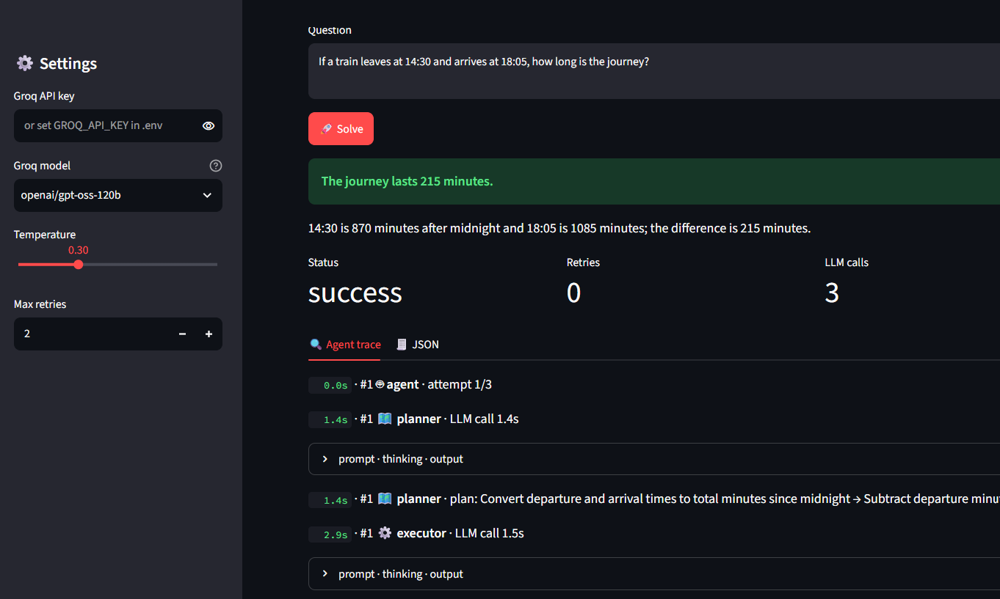

# Multi-Step Reasoning Agent with Self-Checking

An interactive Streamlit application that solves multi-step questions using a planner, executor, and verifier workflow. It displays the final answer, agent trace, retry information, and structured JSON output so users can inspect how the answer was produced.

## Streamlit Demo



*Example shown: the agent calculates the duration between 14:30 and 18:05 as 215 minutes. The interface displays the answer, execution status, retry count, LLM-call count, and agent trace.*

## Key Features

- **Planner–Executor–Verifier workflow:** separates planning, execution, and answer checking into agent roles.
- **Self-checking and retries:** supports retrying a result when verification or execution requires another attempt, subject to the configured retry limit.
- **Agent trace:** inspect the sequence of agent events and expand prompt/thinking/output sections where available.
- **JSON view:** inspect the structured result returned by the workflow.
- **Interactive Streamlit interface:** configure the model, temperature, and maximum retries, enter a question, and run the agent.
- **Test suite:** includes test files for checking agent behaviour.

## Example

**Question:** If a train leaves at 14:30 and arrives at 18:05, how long is the journey?

**Displayed result:** 215 minutes (3 hours and 35 minutes).

The demo screenshot shows a successful run with zero retries and three LLM calls. These are example values from the captured run, not guaranteed values for every question.

## Architecture

1. **Planner** — turns the question into a sequence of steps.
2. **Executor** — works through the plan and produces a candidate answer.
3. **Verifier** — checks the candidate result and can trigger a retry when needed.
4. **Streamlit UI** — presents the answer, status, agent trace, and JSON result.

## Repository Structure

The GitHub repository shown in the screenshot currently contains:

```text
.
├── agents.py
├── example_runs.md
├── prompts.py
├── requirements.txt
├── test_agents.py
├── README.md
└── .gitignore
```

The local VS Code folder shown in the screenshot has `agent.py`, `app.py`, `prompts.py`, `tests.py`, and supporting files. **The local and GitHub file lists differ.** Before submitting, confirm which local files are the current working versions and deliberately add/rename the required files so the repository contains the code needed to run the demo. Do not delete the existing GitHub files simply to make the lists match unless you have checked their contents.

## Run Locally

Use the commands below from the project folder in PowerShell. The exact dependency list and app entry point should match the files in your repository.

```powershell
python -m venv .venv
.\.venv\Scripts\Activate.ps1
pip install -r requirements.txt
python -m streamlit run app.py
```

If the app's entry point is named differently in the final repository, replace `app.py` with the correct filename. Keep API keys in a local `.env` file and **never commit `.env` or API keys**.

## Configuration and Safety

- Configure the Groq API key using the app's expected environment variable or the local `.env` file.
- Select a model supported by the configured provider.
- Avoid committing `.env`, virtual-environment folders, logs, caches, or other local-only files.
- The trace is useful for debugging, but it may contain prompts or intermediate model outputs; review it before sharing publicly.

## Technologies

Python, Streamlit, LLM API integration, multi-agent orchestration, and automated tests.

## Future Improvements

- Add clearer verifier scores and structured pass/fail reasons.
- Add more unit tests for tricky questions and retry behaviour.
- Log token usage and latency per agent.
- Add support for more question types and compare results across models.
- Provide a downloadable run report containing the question, final answer, and verification status.
